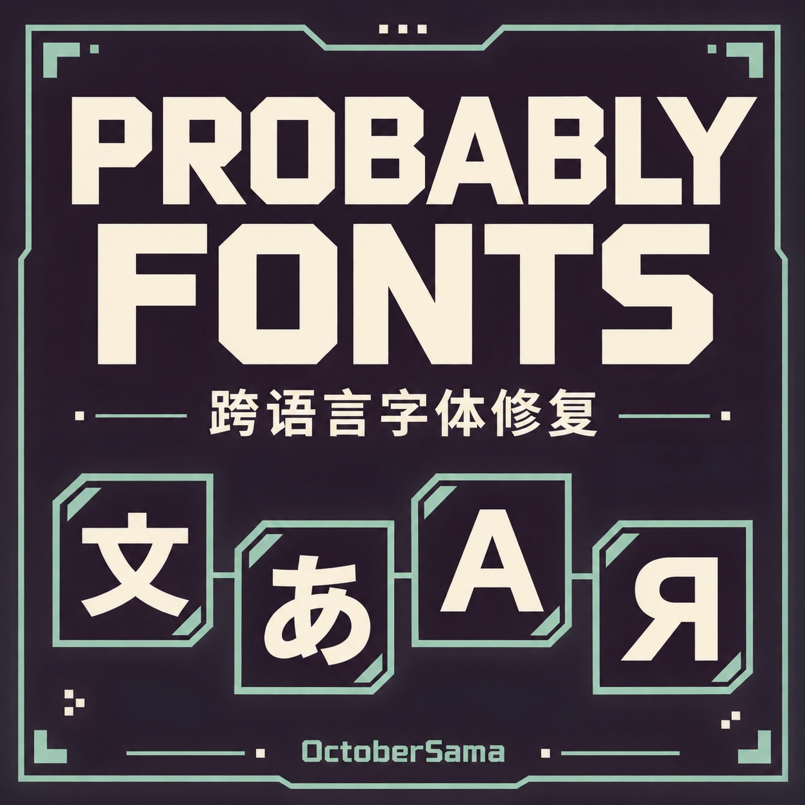

# ProbablyFonts

<p align="center">
  
</p>

改善《深空当铺：可能是偷的》（Probably Stolen）里其他语言文字缺字、显示过细或粗细混杂的问题。例如，游戏使用英语时，模组里的中文也能使用合适的游戏内置字体显示。

本模组不下载外部字体，不修改翻译或游戏语言。启用后自动工作，不需要单独设置。

## 效果演示

<p align="center">
  <a href="docs/assets/font-preview.png"></a>
</p>

点击演示图可查看原图。图中的语言选项由 ProbablyEdited 提供，用来展示字体效果，并不是 ProbablyFonts 的设置页。

## 安装

1. 将构建产物中的整个 `dist/ProbablyFonts/` 文件夹复制到游戏 `Mods/` 目录。
2. 在游戏模组列表启用 **ProbablyFonts** 并重启游戏；之后使用游戏原有的语言选项即可。
3. 如果还要使用 [ProbablyEdited](https://github.com/Octobersama/ProbablyEdited)，请先启用 ProbablyFonts，再启用编辑器。游戏只会提示缺少依赖，不会自动安装；Steam 也不会自动订阅它们。

其他字体修复模组可能会修改同一批字体。建议先只启用 ProbablyFonts；需要比较效果时，一次启用一个字体模组。

不想用了，在模组列表停用并重启游戏即可。本模组不保存游戏进度或个人预设。

## 构建

需要 .NET SDK 和本机安装的游戏；编译引用游戏程序集，但不会将这些程序集复制进模组包。模组目标为 `netstandard2.1`，纯逻辑检查项目使用 .NET 10。构建会生成 `dist/ProbablyFonts/`。

```powershell
dotnet build ProbablyFonts.csproj -c Release
dotnet run --project tests/ProbablyFonts.PureChecks -c Release
```

游戏安装在非默认位置时，指定 `GameDirectory`：

```powershell
dotnet build ProbablyFonts.csproj -c Release -p:GameDirectory="D:\SteamLibrary\steamapps\common\Probably Stolen"
```

GitHub Actions 会在推送提交、提交 pull request 或手动运行时，用 .NET 10 执行 `ProbablyFonts.PureChecks`，不需要安装游戏。运行结束后，可以在 Actions 页面下载 `ProbablyFonts-console-check-results`，里面是测试日志和 `summary.txt`。这些是检查结果，不是模组安装包；完整安装包仍需在装有游戏的本机按上述命令构建。

提交信息含 `[skip ci]`、`[ci skip]`、`[no ci]`、`[skip actions]` 或 `[actions skip]` 时，GitHub 会跳过对应的自动工作流；手动运行不受这些标记影响。

源码：[ProbablyFonts](https://github.com/Octobersama/ProbablyFonts)。

## 字体行为与边界

- 尽量保留原来的字体风格。当前字体缺少某个字时，会尝试用游戏自带的其他字体补上；颜色、描边等仍跟随原控件。
- 有日文假名时优先使用日文字形，有韩文谚文时使用韩文字形，注音符号使用中文字形。只有汉字时无法可靠区分中文和日文，会采用中文字形。
- 如果游戏自带字体也没有所需字形，仍可能缺字。模组会记录警告，但不会换掉原文或编造字形。
- 本模组通过 Harmony 适配游戏的 TextMesh Pro 字体处理。`manifest.xml` 当前声明游戏版本 `0.46D` 和 `1.0.0`；这些声明不保证所有客户端构建都兼容。游戏更新可能改变内部方法或字体结构，更新后应在目标客户端检查实际字形和界面。

## 许可证

Copyright © 2026 OctoberSama。项目代码、文档和原创封面采用 [Apache License 2.0](LICENSE)，署名见 [NOTICE](NOTICE)。演示截图中的原游戏内容及游戏字体仍属于原权利人，本项目许可不授予这些资产的再分发权。
