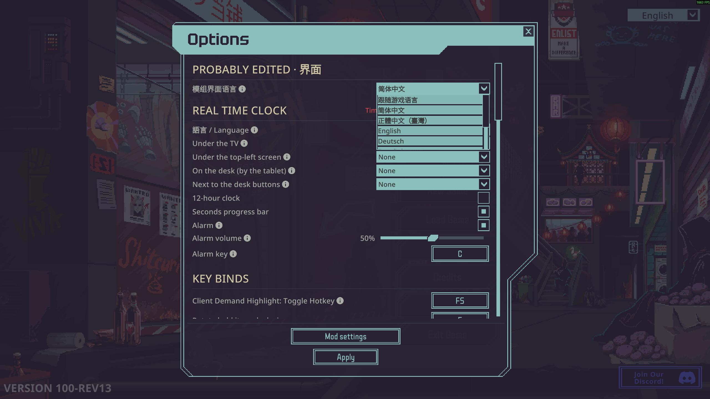

# ProbablyFonts

<p align="center">
  
</p>

修复《深空当铺：可能是偷的》（Probably Stolen）中选择非CJK语言时/Debug控制台的CJK文字显示问题。

本模组独立运行，不需要安装 ProbablyEdited。

----
## 效果演示

<p align="center">
  <a href="docs/assets/font-preview.png"></a>
</p>

## 安装

### Steam创意工坊订阅（推荐）

（占位）

### 从Releases下载

1. 下载[本模组](https://github.com/Octobersama/ProbablyFonts/releases)的最新releases，解压后将模组文件夹放进 `Steam\steamapps\common\Probably Stolen\Mods`。
2. 在游戏模组列表启用 **ProbablyFonts** 并重启游戏。

**请不要与其他功能相同或相似的模组一起使用。**

## 构建

需要 .NET SDK 和本机安装的游戏；编译引用游戏程序集，但不会将这些程序集复制进模组包。模组目标为 `netstandard2.1`，纯逻辑检查项目使用 .NET 10。构建会生成 `dist/ProbablyFonts/`。

```powershell
dotnet build ProbablyFonts.csproj -c Release
dotnet run --project tests/ProbablyFonts.PureChecks -c Release
```

游戏安装在非默认位置时，指定 `GameDirectory`：

```powershell
dotnet build ProbablyFonts.csproj -c Release -p:GameDirectory="D:\SteamLibrary\steamapps\common\Probably Stolen"
```

维护者发布新版本时，可按[自动发布指南](docs/releasing.md)运行脚本：更改日志手写，版本同步、构建、ZIP 打包和逐文件 SHA-512／MD5 表自动生成。

## 字体行为与边界

- 尽量保留原来的字体风格。当前字体缺少某个字时，会尝试用游戏自带的其他字体补上；颜色、描边等仍跟随原控件。
- 有日文假名时优先使用日文字形，有韩文谚文时使用韩文字形，注音符号使用中文字形。只有汉字时无法可靠区分中文和日文，会采用中文字形。
- 如果游戏自带字体也没有所需字形，仍可能缺字。模组会记录警告，但不会换掉原文或编造字形。
- 本模组通过 Harmony 适配游戏的 TextMesh Pro 字体处理。

## 许可证

Copyright © 2026 OctoberSama。项目代码、文档和原创封面采用 [Apache License 2.0](LICENSE)，署名见 [NOTICE](NOTICE)。演示截图中的原游戏内容及游戏字体仍属于原权利人，本项目许可不授予这些资产的再分发权。
